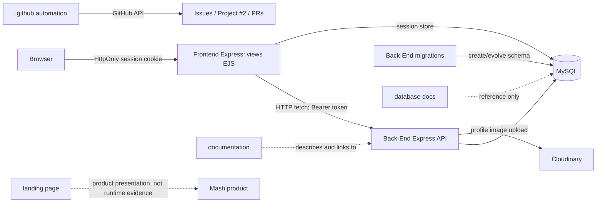

# Arquitetura cross-repo do Mash

Este documento descreve as fronteiras técnicas comprovadas, não a arquitetura futura desejada. Status de Issue, Sprint e PR devem ser consultados ao vivo no [Project #2](https://github.com/orgs/conloq/projects/2), Issues e PRs.

## Repositórios e responsabilidades

| Repositório | Responsabilidade | Runtime Mash? | Autoridade local |
|---|---|---:|---|
| `conloq/.github` | Perfil da organização, templates, workflows e automação GitHub | Não | Workflows/configuração e código de automação |
| `conloq/Back-End` | API REST, regras de negócio, persistência e migrations executáveis | Sim | Código e configuração no SHA; migrations para criação/evolução de schema |
| `conloq/frontend` | Aplicação web; telas EJS com sessão no servidor, que chamam a API REST | Sim | `index.js`, `controllers/pageController.js`, views e manifest |
| `conloq/landing-page-conloq` | Apresentação institucional/comercial da visão completa do produto | Não | Conteúdo e assets da própria página; não comprova implementação Mash |
| `conloq/conloq` | Repositório institucional da organização | Não | Conteúdo institucional; package Python existente é stub observado, não runtime Mash |
| `conloq/database` | Documentação e referência de banco/schema | Não | Artefatos documentais; não substituem migrations |
| `conloq/documentation` | Documentação técnica, funcional e acadêmica | Não | Documentos por área e decisões com referências |
| `conloq/mash` | Issues/roadmap do projeto e código legado | Não é runtime atual | Issue #66 para intenção/decisões; não é prova de execução atual |

## Runtime observado

- `frontend` renders EJS pages and calls the Back-End API from its Express server (`controllers/pageController.js`) with a Bearer token; the JWT stays in the server-side session persisted in the MySQL `sessions` table, and the browser holds only the `HttpOnly` session cookie. The frontend repository does not own API business rules.
- Back-End is the runtime API and uses Sequelize/MySQL. **Back-End migrations are the canonical schema creation/evolution mechanism.** SQL and diagrams in `database` are reference material.
- Back-End uploads user profile images through Cloudinary (`config/cloudinary.js`, `controllers/userController.js`); that integration does not prove iodine image upload or analysis.
- `.github` automation operates on GitHub work items; it is not in the HTTP request path of the product.
- The landing page presents the complete product vision. It is not a runtime consumer or an authority for implemented functionality.
- The institutional `conloq` repository is not part of Mash runtime. Its current Python package is a stub/placeholder; no runtime role or roadmap is inferred from it.

## Functional boundary: iodine and adjacent work

| Surface | Technical state | Evidence boundary |
|---|---|---|
| Iodine-test UI/demo | `SIMULATED` in frontend | Frontend `controllers/pageController.js` / iodine demo view and `conloq/mash#9`; inspect the current `main` |
| Real image upload and storage for iodine | `PLANNED` | `conloq/mash#33` and #66; not established by product-presentation copy |
| OpenCV/image analysis | `PLANNED` | `conloq/mash#34` and #66 |
| Real iodine analysis query/history | `PLANNED` | `conloq/mash#1`, #3, #11, #33, #66 |
| Lots API/workflow | `NOT_IMPLEMENTED` in the inspected API SHA; `PLANNED` in roadmap | `Back-End/app.js` mounts user, recipe, Swagger, and temperature routers, not a lots router; `conloq/mash#31`, #66 record intent |
| Temperature ramps | `IMPLEMENTED` in the current API/frontend scope; verify exact behavior on the current `main` | `Back-End/app.js`, `Back-End/routes/temperatureRoutes.js`, `frontend/controllers/pageController.js`; see `conloq/mash#66` for scope |

“Planned” records durable project intent, not a promise that the feature is implemented. For a task-specific classification, inspect both the code and live issue/PR state. If they disagree, report `DIVERGENT` and stop before relying on either.

## Contracts and sources

- **Implementation**: repository code/configuration at the exact target SHA.
- **API**: Back-End route/controller/service implementation and `config/swagger.json`; compare frontend consumers. Swagger is a contract artifact, not proof that a route is mounted or works.
- **Schema**: executable Back-End migrations. `database` artifacts are documentation/reference.
- **Intent and durable decisions**: relevant section of `conloq/mash#66`, plus canonical technical documentation. An Issue cannot prove implementation.
- **Operational state**: Project #2, Issues, PRs, branches, checks, protections, and rulesets queried live.
- **Landing content**: evidence of product presentation/vision only.

## Cross-repo dependency edges

| Source | Destination | Type | Evidence to verify at target SHA |
|---|---|---|---|
| `frontend` | `Back-End` | Server-side HTTP API consumer | `frontend/controllers/pageController.js`; `Back-End/app.js`, `Back-End/routes/` |
| `Back-End` | MySQL | Runtime persistence | `Back-End/config/data-base.js`, `Back-End/config/sequelize-config.js`, models |
| Back-End migrations | MySQL schema | Executable schema creation/evolution | `Back-End/migrations/`, migration scripts in `Back-End/package.json` |
| `Back-End` | Cloudinary | External profile-image storage | `Back-End/config/cloudinary.js`, `Back-End/controllers/userController.js` |
| `.github` automation | GitHub Issues/Project/PRs | Workflow/API automation | `.github` repo: `.github/workflows/mash-project-notifications.yml`, `automation/` |
| `documentation` | Back-End/frontend/database | Human documentation/reference | Linked docs in `documentation/` (not runtime imports) |
| `database` | Mash schema | Reference documentation | `database/README.md` and SQL/diagram/evidence files; not executable runtime dependency |

No package import, Docker image dependency, or direct runtime edge is asserted between the institutional repo or landing page and the API. Confirm any new edge from manifests, code, workflow inputs, or network calls before adding it here.

### Document freshness note

`database/README.md` describes a local schema observation and links to the Back-End migrations on `main`; code-boundary claims in this document were checked against the `main` branch of each repository. The database repository remains reference material; use migrations at the current Back-End `main` as schema authority and re-verify before database work.

## Integration policy boundary

Team policy: work on a branch and use a Pull Request; required human approvals are zero. Enforcement is not static documentation: check branch protection/rulesets, required checks, conversation resolution, and actor permissions live for the target repository and branch. Never state that a PR is mergeable from this document alone.

## Verification evidence

Stable code-boundary claims in this document were checked against the `main` branch of each repository: `conloq/.github`, `conloq/documentation`, `conloq/frontend`, `conloq/landing-page-conloq`, `conloq/conloq` and `conloq/Back-End`. Re-verify a claim when `main` has moved since the read; do not record commit SHAs or volatile board state here.

Issue/Project statements are live references, not snapshots. Re-verify code claims at the current `main` of the target repository.
