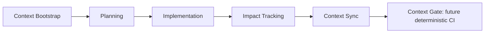

# Context lifecycle (conceitual)

Esta é uma orientação portátil para agentes e colaboradores. Ela não implementa hook, script, workflow, Context Gate ou automação. Harnesses diferentes devem poder seguir o mesmo processo usando arquivos versionados e acesso ao GitHub.

## Lifecycle

### 1. Context Bootstrap

Antes de planejar tarefa não trivial:

1. Para cada repositório potencialmente afetado, identifique organização, repositório, branch/ref e SHA alvo próprios; registre também tarefa, Issue/PR e escopo autorizado.
2. Leia `conloq/.github/PROJECT_CONTEXT.md` e o `AGENTS.md` local, se existirem.
3. Consulte Project #2, Issue, PR, checks, branches e proteção/rulesets relevantes ao vivo.
4. Inspecione código/configuração no SHA alvo, testes, contratos, manifests e consumidores.
5. Consulte documentação/decisões relevantes e o mapa cross-repo; não trate README, Issue ou landing como prova de implementação.
6. Classifique afirmações e registre evidência citável:
   - `CONFIRMED`: provado por fonte autoritativa atual;
   - `DOC_ONLY`: existe em intenção/documento, sem prova de execução;
   - `DIVERGENT`: fontes relevantes discordam materialmente;
   - `UNKNOWN`: não foi possível provar.
7. Se `DIVERGENT` ou `UNKNOWN` afetar escopo, arquitetura, contrato, dependência, segurança, governança ou DoD, pare. Não planeje nem continue silenciosamente até a fonte/decisão ser esclarecida ou uma hipótese explicitamente autorizada.

Tarefa pequena, localizada e reversível pode usar Bootstrap reduzido: confirme repo/branch/ref/SHA do repositório-alvo, leia entrypoints e código diretamente afetado, verifique chamadas/testes imediatos e consulte Issue/PR vinculada. Se surgir impacto material ou dúvida cross-repo, amplie o Bootstrap e identifique branch/ref/SHA de cada repo candidato antes de continuar.

### 2. Planning

Planeje somente depois do Bootstrap. Delimite superfícies afetadas e candidatas cross-repo, critérios observáveis, validação e estado que exige decisão humana. Não transforme recomendações em autorização para mutar Issues, Project ou políticas.

### 3. Implementation and Impact Tracking

Durante a edição, mantenha uma lista de arquivos e superfícies potencialmente afetadas. Mudança de código, configuração ou contrato pode afetar testes, documentação, setup, consumidores de outros repos, workflows, segurança ou metadados de PR/Issue. Tracking significa avaliar impacto; não significa editar documentação em todo commit.

### 4. Context Sync

Antes de declarar conclusão, reavalie o diff e cada superfície potencialmente afetada. Estados conceituais:

- `CHECKED`: verificada com evidência;
- `AFFECTED`: mudança exige atualização/ação ainda pendente;
- `NOT_AFFECTED`: verificada e sem impacto material;
- `UPDATED`: a fonte afetada foi alterada, mas isso não prova que a atualização está correta; registre `CHECKED` separadamente, com evidência posterior à edição.
- `NEEDS_REVIEW`: exige decisão ou validação humana;
- `BLOCKED`: não pode prosseguir com a evidência/autoridade atual;
- `UNKNOWN`: não foi possível verificar.

Uma superfície marcada `AFFECTED` não pode desaparecer do resultado. Para `PASS`, toda superfície aplicável precisa de `CHECKED` com evidência; cada superfície afetada também precisa de `UPDATED` e de verificação pós-atualização. `UNKNOWN`, `BLOCKED`, `NEEDS_REVIEW` material ou `AFFECTED` sem atualização impedem `PASS`.

Verifique, conforme aplicável: implementação, API/schema, testes, docs técnicas/funcionais, arquitetura/decisões, README/AGENTS, comandos/setup, dependências, consumers cross-repo, workflows/CI, segurança, Issue/PR/Project e release/deploy metadata.

### 5. Context Gate (futuro)

Um gate futuro deve validar somente fatos determinísticos (por exemplo, links/paths, contrato gerado, presença de evidência de sync quando exigida). Ele não decide intenção de produto, prioridade, status, arquitetura ou divergência semântica; esses pontos exigem humano/agente autorizado.

## Local and project synchronization

### `LOCAL_SYNC`

`LOCAL_SYNC = PASS` significa apenas que o repositório e o head SHA da mudança estão internamente consistentes: implementação, testes, contratos, documentação e comandos locais aplicáveis foram avaliados. Não declara nada sobre outros repos.

### `PROJECT_SYNC`

`PROJECT_SYNC = PASS` somente quando todos os repos/superfícies potencialmente afetados foram identificados pelo mapa cross-repo e verificados. Cada superfície precisa estar `CHECKED` com evidência; as afetadas precisam estar `UPDATED` e `CHECKED` novamente após a atualização, sem impacto pendente ou divergência material.

Resultados conceituais:

- `PASS`: todas as superfícies aplicáveis têm evidência de `CHECKED`; cada superfície afetada também foi `UPDATED` e verificada novamente depois da atualização; não há impacto pendente nem divergência material.
- `BLOCKED`: falta acesso, autorização, evidência ou uma dependência/material impact permanece pendente.
- `NEEDS_REVIEW`: requer decisão/avaliação humana, sem contradição factual não resolvida sendo escondida.
- `UNKNOWN`: não é possível afirmar consistência ou causa com as fontes disponíveis.

`LOCAL_SYNC = PASS` não implica `PROJECT_SYNC = PASS`. Uma dependência cross-repo pendente bloqueia o segundo, não é escondida pelo primeiro.

## `CHANGE_ID`

Use Issue GitHub existente que realmente cobre a mudança, preferencialmente a Issue principal/parent. Formato legível: `conloq/mash#123`. Não use uma Issue de roadmap como Issue de implementação se ela não autorizar/cobrir o trabalho, e não crie sistema próprio de IDs.

## Portabilidade

O núcleo deste lifecycle está em arquivos versionados e usa fontes GitHub/código. Skills e adapters podem automatizar passos, mas não são autoridades e não são pré-requisitos. Sem hook, execute manualmente os mesmos passos e registre evidências no PR.