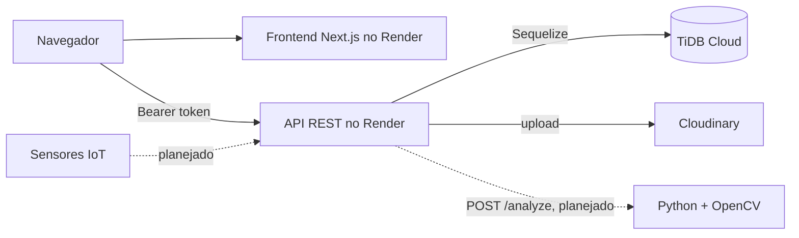

# Infraestrutura

Documentação de infraestrutura e DevOps do projeto Mash.

## Fonte

A topologia, o endereçamento e os componentes abaixo são a proposta de rede física da sala técnica dos artefatos do PI. Não descrevem a rede implantada: o sistema publicado roda em nuvem, conforme a seção Ambiente do depósito. O ambiente local observado está registrado em [database/evidencias](../database/evidencias/README.md).

## Topologia da rede

**Topologia em estrela**: todos os dispositivos conectados a um switch central na sala técnica. O switch está ligado ao modem/roteador (gateway para internet).

## Endereçamento

| Dispositivo | Endereço IP | Função |
|---|---|---|
| Roteador / Gateway | `192.168.0.1` | Acesso à internet |
| Servidor | `192.168.0.2` | Armazenamento, processamento das análises, execução da aplicação |
| Computador da Sala Técnica | `192.168.0.10` | Monitoramento, gerenciamento operacional |
| Dispositivos móveis | DHCP automático | Captura de imagens, acesso remoto via Wi-Fi |

## Componentes

| Componente | Descrição |
|---|---|
| **Roteador / Gateway** | Acesso à internet, gateway padrão, distribuição da comunicação |
| **Switch Central** | Interligação dos dispositivos, estrutura central da topologia estrela |
| **Servidor** | Processamento das análises, execução da aplicação, armazenamento de dados |
| **Computador da Sala Técnica** | Monitoramento, gerenciamento operacional, controle local |
| **Dispositivos Móveis** | Captura das imagens do teste de iodo, acesso remoto via Wi-Fi |

## Rede

- **Cabeada:** Ethernet Cat6 (estabilidade e velocidade)
- **Sem fio:** Ponto de acesso Wi-Fi na sala técnica
- **Servidor:** IP fixo

## Ambiente do depósito

O depósito usa duas configurações do mesmo sistema: o ambiente de desenvolvimento, na máquina de quem programa, e o ambiente público, no Render desde 24/10/2026, com as evidências das [#68](https://github.com/conloq/mash/issues/68), [#69](https://github.com/conloq/mash/issues/69) e [#41](https://github.com/conloq/mash/issues/41).

### Desenvolvimento local

| Componente | Como roda |
|---|---|
| Frontend | `http://localhost:4000`, com `npm run dev` e `npm run watch:css` em outro terminal |
| API | `http://localhost:8080`, com `npm start`, que aplica as migrations antes de subir |
| Banco | MySQL local, banco `mash`; nas evidências, MariaDB 10.4.32, com as migrations `users`, `recipes` e `temperatures` |
| Imagens | Cloudinary, recebendo a foto de perfil enviada pela API |

O frontend Next.js chama a API direto do navegador: o login devolve o JWT, que fica no `localStorage` (`mash_token`), e um interceptor o envia em `Authorization: Bearer`. A API libera a origem do frontend em `FRONTEND_URL`, com preflight para `Authorization` e `Content-Type`. Não há sessão guardada no servidor: a migration de 28/10/2026 removeu a tabela `sessions`. A documentação interativa da API fica em `GET /api-docs`.

### Implantação pública

| Serviço | Endereço | Issue |
|---|---|---|
| Frontend | <https://frontend-a6u4.onrender.com> | #69 |
| API do Back-End | <https://back-end-xxq5.onrender.com> | #68 |

O navegador carrega as telas do frontend e chama a API direto, com `Authorization: Bearer`. Por isso a API libera a origem pública do frontend no CORS, e o frontend recebe `NEXT_PUBLIC_API_URL` apontando para a API no build: a variável entra no bundle, então mudar a URL exige novo deploy. A API responde pelo Sequelize a partir do banco no TiDB Cloud, compatível com MySQL e com TLS obrigatório. As imagens ficam no Cloudinary, para onde a API envia a foto de perfil.

**Hibernação.** Os dois serviços usam o plano gratuito do Render, que hiberna após 15 minutos sem tráfego. Hibernar é o estado normal do ambiente, não falha de deploy: a primeira requisição depois do repouso demora de 20 a 35 segundos para acordar o serviço (medido em 28/10/2026: 32 s na API e 23 s no frontend), e as seguintes respondem em menos de 1 segundo. Antes de uma demonstração, abra a página uma vez para acordar.

### Arquitetura futura

Dois componentes estão planejados para o próximo semestre e não fazem parte do ambiente publicado: os sensores de temperatura com ingestão IoT ([#36](https://github.com/conloq/mash/issues/36)) e o serviço em Python com OpenCV, `POST /analyze`, chamado apenas pela API ([#34](https://github.com/conloq/mash/issues/34)).

Linha contínua: entregue no depósito. Linha tracejada: planejado para o próximo semestre.

## Diagrama de usabilidade

Fluxo planejado do recorte: conta → receitas/rampas → lotes. O código observado contempla conta, receitas e criação/listagem de rampas; lotes ainda são planejados. A validação do deploy é separada (#68 e #69). O recorte do semestre está centralizado em [geral/README.md](../geral/README.md) e na [#66](https://github.com/conloq/mash/issues/66).

## DevOps

| Aspecto | Estado |
|---|---|
| CI/CD | `conloq/.github` tem o workflow `mash-project-notifications.yml` (notificações de sprint); pipeline de testes nos Pull Requests fica para depois do depósito (#94) |
| Verificações | Evidências na #41; o Back-End tem scripts de verificação, sem inferir validação de todo ambiente publicado |
| Migrations | Fonte do schema desde 12/10/2026: `npm run db:migrate` antes de subir a API e a cada deploy (#71) |
| Deploy | Manual, no Render gratuito: API na #68 (com MySQL externo no TiDB Cloud desde 24/10/2026) e frontend na #69 (decisão de 13/10/2026, substitui Railway) |
| Monitoramento | mash_project_notifier (Python, em .github) |

